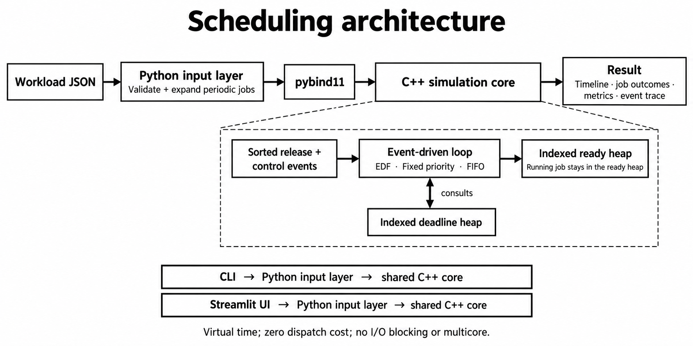
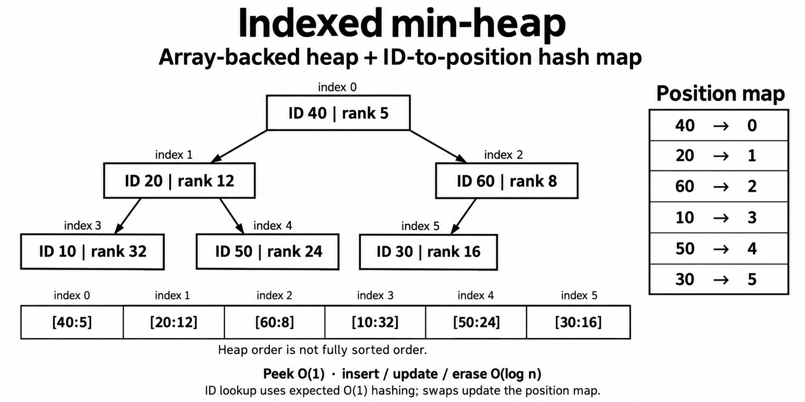
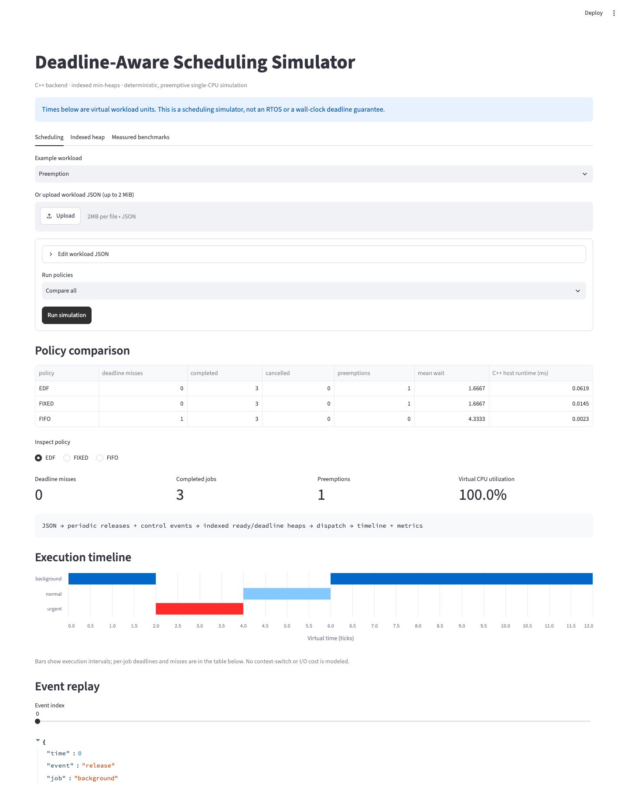
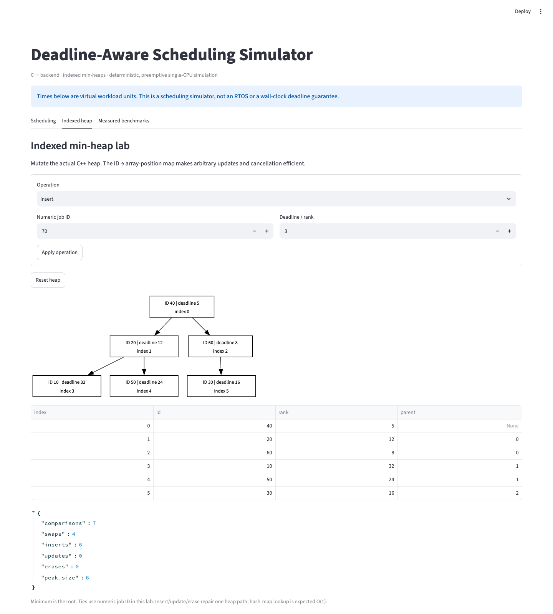

# CPU Scheduling Simulator

A C++17 backend for studying **which ready job should run next** when execution time and deadlines compete for one CPU. It implements its own indexed min-heap, compares preemptive Earliest Deadline First (EDF), preemptive Fixed Priority and non-preemptive FIFO, and produces reproducible execution timelines, deadline-miss events and per-job outcomes.

**Indexed min-heap · ID-to-position hash map · arbitrary erase/update · event-driven simulation · independent differential tests**

This is a virtual-time simulator with known execution demands and zero dispatch cost. It does not run user functions, control hardware or provide operating-system real-time guarantees.

## Architecture



Python handles JSON, periodic expansion, presentation and tooling. **All job selection, preemption, cancellation, deadline tracking, heap mutations and metrics run in C++.** The UI calls the native library directly; no HTTP API or subprocess per simulation is needed.

## The DSA at the center



| Structure | Purpose | Cost |
|---|---|---|
| Indexed binary min-heap | Ready-job ordering and direct update/removal by ID | Peek O(1); repair O(log n) |
| Hash map: job ID → heap index | Locate an arbitrary job without a linear scan | Expected O(1), worst case O(n) |
| Second indexed min-heap | Next unresolved active deadline | O(log n) insert/update/remove |
| Stable-sorted vectors + cursors | Release and control-event streams | O(n log n) setup; O(1) advance |
| Append-only vectors | Timeline intervals and audit events | Amortized O(1) append |

The ready heap includes the running job. Its rank stays fixed while remaining execution decreases, so there is no erase/reinsert on every event. Heap swaps repair **both** ID-to-position entries. Cancellation removes the entry immediately; there are no stale tombstones to accumulate.

The Streamlit heap lab exposes the actual native heap array and map positions. See [architecture and semantics](docs/ARCHITECTURE.md) for invariants, boundary ordering and complexity assumptions.

## Quick start: macOS

Requirements: a C++17 compiler (`clang++` by default), `make`, and Python 3.13 (the tested Python version). No GPU, external API key or database is required.

```sh
# Install Apple's compiler tools if needed:
xcode-select --install

# Clone and enter the project:
git clone https://github.com/pigglegiggle/cpu-scheduling-simulator.git
cd cpu-scheduling-simulator
make setup
make test
make demo
make ui
```

Open **<http://127.0.0.1:8502>**. Ctrl+C stops the UI. `make setup` installs pinned Python packages in `.venv` and builds the native binding; later runs need only `make ui`. The port is 8502 so it can coexist with a local search app on 8501.

The C++ test and benchmark executables are also independent of Python:

```sh
make
./build/core_tests
./build/benchmark
```

### Linux / Windows through WSL2

Inside Ubuntu (including WSL2):

```sh
sudo apt update
sudo apt install -y build-essential clang git python3 python3-dev python3-venv
cd /path/to/cpu-scheduling-simulator
make setup
make test
make ui
```

Keep the repository and environment in the Linux filesystem under WSL. Use `http://localhost:8502` in the Windows browser. Native MSVC/Windows builds are not configured. This project has been executed on macOS; the Linux/WSL instructions have not been executed here. Python packages must be built/installed for the interpreter used inside that environment.

## CLI

```sh
# Run a policy; output is JSON.
.venv/bin/python -m scheduler run examples/preemption.json --policy edf

# Compare identical inputs across EDF, fixed priority and FIFO.
.venv/bin/python -m scheduler compare examples/frame_pipeline.json \
  --output build/comparison.json

# Validate input and core constraints (executes an untraced validation simulation).
.venv/bin/python -m scheduler validate examples/dynamic_updates.json

# Omit audit events for a larger run; timeline and job outcomes remain.
.venv/bin/python -m scheduler run examples/overload.json --no-trace
```

`engine_wall_ms` measures native simulation/validation and result construction, excluding Python result conversion, JSON output and page rendering. Workload times are **virtual** units, not this host timer.

## Who chooses a deadline?

The workload designer does. The scheduler consumes it and chooses among jobs already released. For example:

```json
{
  "name": "Urgent inspection interrupts background processing",
  "time_unit": "ms",
  "jobs": [
    {"id": "background", "release": 0, "execution": 8, "deadline": 20, "priority": 5},
    {"id": "inspection", "release": 2, "execution": 2, "deadline": 5, "priority": 0}
  ]
}
```

EDF runs background from 0–2, inspection from 2–4, then background from 4–10. FIFO finishes background first and inspection at 10, missing its deadline of 5. This illustrates a scheduling decision; these numbers are not requirements measured on a real inspection machine.

All times are integer ticks. `time_unit` (`ticks`, `ms`, `us`) is a display label; it does not change execution or sleep on the host. Job deadlines are **absolute** times. Periodic templates use `relative_deadline`, expanded as `offset + occurrence × period + relative_deadline`.

```json
{
  "periodic": [
    {"id": "audio", "period": 5, "execution": 1, "relative_deadline": 5, "count": 10, "priority": 0}
  ],
  "actions": [
    {"time": 2, "job": "audio#0", "kind": "deadline", "value": 4},
    {"time": 3, "job": "audio#1", "kind": "cancel"}
  ]
}
```

Actions can cancel jobs or update their absolute deadline/priority. Lower numeric priority wins under Fixed Priority. Ties use release sequence, then job input order for simultaneous releases. EDF ties do **not** use the priority field. FIFO has no time quantum and is non-preemptive. See the [input and result reference](docs/WORKLOAD_FORMAT.md).

## Simple UI



1. Select an example or upload JSON; edit the input and run one policy or compare all three.
2. Inspect deadline misses, preemptions, per-job finish times and the execution timeline.
3. Move the event-replay slider to inspect releases, updates, dispatches and misses.
4. Open **Indexed heap** to insert/update/cancel IDs and inspect the actual C++ tree and counters.
5. Open **Measured benchmarks** for retained observations rather than synthetic UI claims.



The UI accepts at most 2,000 expanded jobs and 2 MiB JSON, and displays the first 300 timeline segments with an explicit notice when truncated. Downloaded results retain the complete timeline. The heap lab is limited to 100 nodes for readability. Simulation results and inputs stay in the local process; there is no shared database or public deployment configuration.

## Tests and measured performance

```sh
make test
make sanitize
make benchmark
```

- Seeded indexed-heap mutation tests compare against an independent ordered reference and check the map/heap invariant after every operation.
- **6,000 policy/workload cases** compare the event-driven engine against an independently implemented tick-by-tick simulator, including dynamic cancellations and updates.
- Boundary tests cover exact deadlines, cancellation at release, historical misses after deadline extension, long idle jumps, ties and invalid inputs.
- Python tests cover periodic expansion, strict JSON, native validation, CLI export, policy repeatability and Streamlit interaction.
- The benchmark compares native indexed-heap mutation + minimum lookup against a linear-scan reference at **1K, 10K and 100K entries**, verifies each minimum ID, and records separate whole-simulation wall times.

See the [measured report](docs/PERFORMANCE_REPORT.md), [benchmark method](docs/BENCHMARKS.md) and [raw JSON](docs/benchmarks/latest.json). Batch-amortized µs/op is not per-request p50 latency; virtual deadline results are not hardware timing guarantees.

## Scope and limits

- One CPU, fully preemptible jobs, known positive execution demands, no I/O waits, locks, task dependencies or context-switch costs in simulated time.
- Missed jobs continue running; there is no automatic dropping. A miss is recorded once and remains recorded if the deadline is later extended. Cancelled jobs retain any miss already observed.
- At an event timestamp: **completion → control actions in input order → releases → deadline checks → dispatch**. Finishing exactly at a deadline succeeds. Cancellation exactly at an unresolved deadline prevents that miss from being recorded.
- Core/CLI: 1–100,000 expanded jobs, at most 100,000 actions; releases/deadlines/action times 0–10¹², execution 1–10⁹, priorities 0–1,000,000. Deadline must be ≥ release. IDs are unique printable ASCII without spaces, at most 80 characters. Event trace is bounded at 1,000,000 rows.
- JSON input is bounded at 2 MiB and rejects duplicate keys, unknown fields, non-integer times, booleans as integers and non-finite numbers. Results are kept in memory; large traces and JSON serialization consume additional RAM.
- EDF is not claimed to minimize misses for every overloaded workload. All policy comparisons must use the same workload and stated assumptions.
- Sanitizer, runtime and benchmark evidence comes from the host environment; no QEMU, MCU firmware or hardware measurements are included.

## Repository map

```text
include/das/indexed_heap.hpp   Indexed min-heap, map invariants, counters
include/das/scheduler.hpp      Public C++ workload/result types
src/scheduler.cpp              Event loop, policies, preemption and metrics
bindings/python.cpp           Native bridge; releases GIL for simulation
scheduler/                    Strict JSON, periodic expansion and CLI
web/ui.py                     Thin Streamlit workbench and heap inspector
tests/                        Independent references, boundary/UI tests, benchmark
examples/                     Small reproducible workloads
docs/                         Architecture, format, run guide, measured report
study/                        Private learning notes (ignored by Git)
```

Public documentation: [How to run](docs/HOW_TO_RUN.md), [architecture](docs/ARCHITECTURE.md), [input format](docs/WORKLOAD_FORMAT.md), [benchmark methodology](docs/BENCHMARKS.md). Architecture images were generated with imagegen from the implemented design; [prompts](docs/images/prompts.md) are retained.
